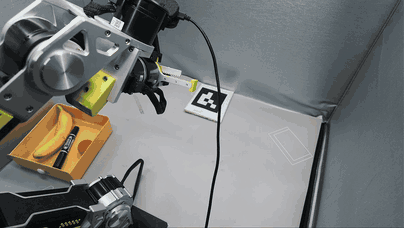
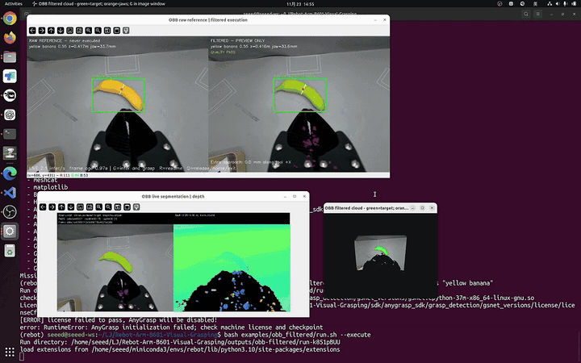
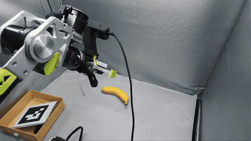
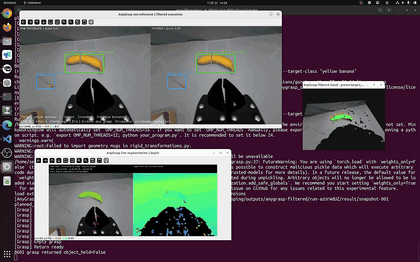

# reBot Arm B601 Visual Grasping

[简体中文](README_zh.md)

Use an RGB-D camera to identify objects, estimate grasp poses, and pick objects with a reBot Arm B601. The project includes OBB, filtered OBB, AnyGrasp, and GraspNet examples. This guide starts with a fresh Ubuntu environment and uses the B601-RS and Orbbec Gemini 336 as the reference setup. AnyGrasp also requires an NVIDIA GPU, a compatible CUDA environment, and an official license.

On Ubuntu x86-64, install Git and curl. AnyGrasp and GraspNet also need an NVIDIA driver that lists your GPU when you run `nvidia-smi -L`. Clone the project and run the commands below from the repository root.

```bash
git clone https://github.com/LAN-GER/Rebot-Arm-B601-Visual-Grasping.git
cd Rebot-Arm-B601-Visual-Grasping
```

Set `camera.type` to your camera model. The default is `orbbec_gemini336` at 640×480 and 30 FPS. Use `camera.serial` to select among cameras of the same model. [Default configuration](config/default.yaml)

Choose one installation method. [Automatic setup](#1-automatic-environment-and-sdk-setup) · [Manual setup](#2-manual-environment-and-sdk-setup) · [Script entry points](#script-entry-points)

## 1. Automatic environment and SDK setup

Run the checker to see what is missing, run setup to install the missing components, then run the checker again to verify the result. These commands work with the camera and robot disconnected.

```bash
bash scripts/check_env.sh
bash scripts/setup_env.sh
bash scripts/check_env.sh
```

Setup reuses Conda or installs Miniforge in `~/miniforge3`, creates or completes the Python 3.10 environment `rebot`, and installs the configured camera driver. The default setup installs the B601 control SDK, YOLOE and the public dependencies for OBB, AnyGrasp and GraspNet, including missing CUDA operators. To limit the scope, use the same options on the setup and check commands.

| Intended use | Options for both scripts |
| --- | --- |
| All backends and the B601 | No options |
| OBB or filtered OBB camera preview, including on CPU | `--backend obb` |
| AnyGrasp or GraspNet camera preview | `--backend anygrasp` or `--backend graspnet` |
| One backend with the B601 | Add `--robot`, e.g. `--backend anygrasp --robot` |

Missing packages and SDKs install automatically. When an existing package or dependency needs a version or Conda build change, setup shows the current and proposed versions. Enter `y` to apply that transaction. Enter, `n`, or a noninteractive run skips transactions requiring approval. Existing Git SDKs are reused. If a build requires a different SDK branch, setup shows both revisions and asks before switching. The final section below `----` lists the changes actually made.

The checker lists ready and missing or unusable packages, SDKs and runtime files for the selected backends below the final `----`. It lists files you must supply and checks it could not run separately.

On a fresh machine the first check normally reports missing components. `[MANUAL]` marks files you supply, such as the machine-specific AnyGrasp license, its detection weights and the hand–eye matrix. Exit code `3` means only manual items remain. Supply the listed files and rerun the same check. If the GraspNet download hits a quota, pass `--checkpoint-file /path/to/checkpoint-rs.tar` to setup, or set `GRASPNET_CHECKPOINT_URL` to a trusted direct download. Interrupted installations can be rerun. [AnyGrasp authorization and file locations](docs/sdk_setup.md) · [Hand–eye calibration](examples/hand_eye/README.md)

For AnyGrasp, run `bash scripts/anygrasp_license.sh`. Choose `1` to read the machine feature ID or `2` to configure the license and detection weights from the delivery directory. [AnyGrasp license and detection weights](#anygrasp-license-and-detection-weights)

If setup installed Miniforge, first run `source ~/miniforge3/etc/profile.d/conda.sh` in your terminal. Run `conda activate rebot` before launching an example, then continue to [section 3](#3-run-the-examples).

## 2. Manual environment and SDK setup

Start with the common Python and camera steps, then install the SDKs for the examples you plan to use. OBB is implemented in this project and is ready for camera preview after steps 2.1 and 2.2.

### 2.1 Create `rebot` and choose a PyTorch build

With Conda available in the shell, create `rebot` from the project environment file. It includes Python 3.10, NumPy below 2 and Pinocchio 3.9.0 for the B601. If `rebot` already exists with Python 3.10, activate it and install any missing dependencies there. [Environment file](environment.yml) · [Miniforge installation](https://github.com/conda-forge/miniforge#install)

```bash
conda env create -f environment.yml
conda activate rebot
```

**AnyGrasp or GraspNet on an NVIDIA GPU.** The tested combination on the RTX 4080 Laptop GPU uses PyTorch 2.5.1 and CUDA 12.1. The check below should print `12.1` and `True`.

```bash
python -m pip install 'torch==2.5.1+cu121' 'torchvision==0.20.1+cu121' 'torchaudio==2.5.1+cu121' \
  --index-url https://download.pytorch.org/whl/cu121
python -c 'import torch; print(torch.__version__, torch.version.cuda, torch.cuda.is_available())'
```

**OBB on CPU.** For a CPU-only installation, choose this PyTorch command.

```bash
python -m pip install -r requirements-pytorch.txt --index-url https://download.pytorch.org/whl/cpu
```

### 2.2 Install the camera driver and YOLOE

Install the driver that matches `camera.type`. For the Orbbec Gemini 336, run `python -m pip install 'pyorbbecsdk2==2.0.18'`. For a RealSense D405 or D435i, run `python -m pip install 'pyrealsense2>=2.54'`. Configure USB access for the selected device. [Camera SDK guide](docs/sdk_setup.md)

Install the project and fetch the default YOLOE segmentation weights and text encoder. The segmentation weights go in `models/`, and the text encoder goes in the repository root.

```bash
python -m pip install -e '.[obb,yolo,visualization]' scipy
python -m pip install 'git+https://github.com/ultralytics/CLIP.git@7ffa84b3bfa40c42ecc1c77147a855e69cb2dd40'
mkdir -p models
curl -fL --retry 3 -o models/yoloe-26s-seg.pt \
  https://github.com/ultralytics/assets/releases/download/v8.4.0/yoloe-26s-seg.pt
curl -fL --retry 3 -o mobileclip2_b.ts \
  https://github.com/ultralytics/assets/releases/download/v8.4.0/mobileclip2_b.ts
```

### 2.3 Install the B601 control SDK for calibration and robot execution

```bash
git clone https://github.com/Seeed-Projects/reBotArm_control_py.git sdk/reBotArm_control_py
python -m pip install 'motorbridge==0.6.0' 'meshcat>=0.3.2' 'matplotlib>=3.10'
```

If you created `rebot` without the project environment file, install the kinematics dependency with `conda install --override-channels -c conda-forge 'pinocchio=3.9.0' 'numpy<2'`. For a B601-RS, confirm `hardware_yaml: rebotarm_rs.yaml` in `sdk/reBotArm_control_py/config/rebotarm.yaml`, the CAN interface and the URDF before running the arm. The optional stationary calibration example also uses a separate collector and payload model. [B601 configuration and CAN setup](docs/sdk_setup.md) · [Stationary calibration](examples/stationary_calibration/README.md)

### 2.4 Prepare the CUDA build tools for AnyGrasp and GraspNet

Use a C++ compiler compatible with CUDA 12.1. If needed, install one with `conda install --override-channels -c conda-forge 'gcc_linux-64=12' 'gxx_linux-64=12'` and reactivate `rebot`. If you already have a CUDA 12.1 Toolkit, set `CUDA_HOME` to its installation directory. Otherwise install the toolkit into `rebot` as shown below.

```bash
conda install --override-channels -c nvidia/label/cuda-12.1.1 -c conda-forge 'cuda-toolkit=12.1'
export CUDA_HOME="$CONDA_PREFIX"
```

Keep the same shell open for the backend builds. Confirm that `nvcc` reports release 12.1, then install the shared Python dependencies.

```bash
export PATH="$CUDA_HOME/bin:$PATH"
export MAX_JOBS=2
nvcc --version
python -m pip install wheel ninja
python -m pip install 'transforms3d>=0.4.2' \
  'graspnetAPI @ git+https://github.com/graspnet/graspnetAPI.git@eb57dd2092d8dbe05312a29c3d0c22f3226efbfc'
```

### 2.5 Install and authorize AnyGrasp

Build the SDK’s PointNet2 extension in `rebot` and compile MinkowskiEngine with OpenBLAS. Then read the feature ID on the machine that will run inference.

```bash
git clone https://github.com/graspnet/anygrasp_sdk.git sdk/anygrasp_sdk
git clone --branch cuda-12-1 https://github.com/chenxi-wang/MinkowskiEngine.git sdk/MinkowskiEngine-cuda-12-1
conda install --override-channels -c conda-forge 'openblas>=0.3.30,<0.4' 'numpy<2'
python -c 'import ctypes, sys; ctypes.CDLL(sys.prefix + "/lib/libopenblas.so")'
python -m pip install --no-build-isolation --no-deps ./sdk/anygrasp_sdk/pointnet2
(
  cd sdk/MinkowskiEngine-cuda-12-1 &&
  python setup.py bdist_wheel --force_cuda --blas=openblas \
    --blas_include_dirs="$CONDA_PREFIX/include" --blas_library_dirs="$CONDA_PREFIX/lib" &&
  python -m pip install --no-deps dist/*.whl
)
```

#### AnyGrasp license and detection weights

1. **Read the machine feature ID.** Run the command on the machine that will run inference, using its deployment network adapter. In the interactive menu, option `1` does the same. Submit the printed `feature_id` to request the license and detection checkpoint. [Official AnyGrasp registration](https://github.com/graspnet/anygrasp_sdk/tree/main/license_registration)

   ```bash
   bash scripts/anygrasp_license.sh 1
   ```

2. **Install both files from the delivery directory.** Keep the issued license ZIP or extracted license folder alongside `checkpoint_detection.tar`. Run the command below or choose option `2` in the menu and enter the directory path.

   ```text
   delivery/
   ├── license.zip
   └── checkpoint_detection.tar
   ```

   ```bash
   bash scripts/anygrasp_license.sh 2 "/path/to/delivery"
   ```

   The SDK validates the license before installation. The script checks that the detection checkpoint can be read and uses the destinations from `config/backends/anygrasp.yaml`. By default the license goes to `sdk/anygrasp_sdk/grasp_detection/license/` and the weights go to `sdk/anygrasp_sdk/grasp_detection/log/checkpoint_detection.tar`. For a separate filtered-backend checkout or checkpoint path, pass `--backend anygrasp_filtered` before `2`.

3. **Check the result.** The terminal summary below `----` reports the license and weights. If only the license is supplied and the weights are still missing, the script reports `[PARTIAL]` and returns exit code `3`. To finish later, run option `2` with the path to `checkpoint_detection.tar`. An `[ERROR]` result includes the reason, such as a machine ID mismatch or an unreadable checkpoint.

   ```bash
   bash scripts/check_env.sh --backend anygrasp
   ```

   To verify model loading and inference with real RGB-D data, use the camera preview or replay a recorded frame. [AnyGrasp filtered preview and replay](examples/anygrasp_filtered/README.md)

### 2.6 Install GraspNet-Baseline

Install its PointNet2 and kNN extensions inside the Baseline checkout so AnyGrasp can use its own PointNet2 in the same environment.

```bash
git clone https://github.com/graspnet/graspnet-baseline.git sdk/graspnet-baseline
baseline="$PWD/sdk/graspnet-baseline"
python -m pip install --no-build-isolation --no-deps --upgrade --target "$baseline/pointnet2" "$baseline/pointnet2"
touch "$baseline/pointnet2/pointnet2/__init__.py"
python -m pip install --no-build-isolation --no-deps --upgrade --target "$baseline/knn" "$baseline/knn"
mkdir -p "$baseline/checkpoints"
```

Download the official **RealSense** checkpoint and save it as `sdk/graspnet-baseline/checkpoints/checkpoint-rs.tar`. For a different checkpoint, update `checkpoint` in the backend YAML. Relative paths start at that file’s directory. Run `bash scripts/check_env.sh --backend graspnet` to verify the camera-preview dependencies and CUDA operators. [Official pretrained weights](https://github.com/graspnet/graspnet-baseline#training-and-testing) · [GraspNet configuration](config/backends/graspnet.yaml)

After a full manual installation, run `bash scripts/check_env.sh`. For a single backend, pass `--backend obb`, `--backend anygrasp` or `--backend graspnet`. Add `--robot` to include the arm driver and hand–eye matrix. A successful check exits with code `0`.

## 3. Run the examples

### Offline check

The synthetic demo runs on a CPU. The first command generates an RGB-D frame and an OBB grasp candidate. The second replays the same frame. Check `result.json` and the preview image in the output directory.

```bash
run_dir="outputs/setup-$(date +%s%N)"
rebot-grasp demo --output "$run_dir/demo"
rebot-grasp preview --input "$run_dir/demo/frame.npz" --output "$run_dir/replay"
```

### 3.1 Check the camera and preview grasps

Record a frame to check RGB-to-depth alignment, then open the filtered OBB preview. The preview uses only the camera. Press **G** in the window to save the frame and its grasp candidates. The output shows the raw and filtered grasp estimates side by side. [Filtered OBB guide](docs/obb_filtered.md)

```bash
rebot-grasp record --output "outputs/rgbd/frame-$(date +%s%N).npz"
bash examples/obb_filtered/run.sh
```

### 3.2 Run hand–eye calibration

Check the ArUco marker before starting calibration. The default board uses a **100 mm marker with ID 0**. Measure the black marker edge after printing and enter its length in meters under `calibration.aruco.marker_length_m`. The first command opens the camera for a marker check. Clear the arm's travel area before running the second command, which moves it through the calibration trajectory. [Calibration instructions and printable boards](examples/hand_eye/README.md)

```bash
bash examples/hand_eye/run.sh --check-marker
bash examples/hand_eye/run.sh
```



For the Gemini 336, a successful calibration writes `config/calibration/orbbec_gemini336/hand_eye.npz`. Recalibrate if you change the camera or its mounting position. Point `calibration.hand_eye_path` to the matrix for the current setup.

### 3.3 Execute an OBB or AnyGrasp pick

**Filtered OBB.** Once the preview and calibration are correct, run with `--execute`. The arm first moves to its ready pose. Press **G** to capture a fresh frame and attempt a pick. Press **Q** or **Esc** to end the session.

```bash
bash examples/obb_filtered/run.sh --execute
```



**Filtered AnyGrasp.** The first command opens the camera and loads the model. The left pane displays grasp candidates from the raw point cloud and the right pane displays candidates from the filtered cloud. The second command moves the arm to the ready pose. Press **G** to attempt a pick on the selected class using a candidate from the right pane that passes workspace and inverse kinematics checks.

```bash
bash examples/anygrasp_filtered/run.sh
bash examples/anygrasp_filtered/run.sh --execute --target-class "yellow banana"
```

<p>
  
  
</p>

In the image window, **1** selects the pen, **2** selects the orange, and **3** selects the banana. The order follows `yolo.custom_classes` in the configuration. A green box and white grasp line mark the selected target. Blue boxes and yellow lines mark other targets. The red dot is the grasp center between the jaws, and `Z` is its depth in camera coordinates. The arm skips the pick if the target is missing, the depth check fails, or no candidate is reachable. Press **Q** or **Esc** to end the session. [Filtered AnyGrasp guide](examples/anygrasp_filtered/README.md)

**If the grasp is too shallow**, append `--insertion-depth-mm <mm>` to either filtered execution command and replace `<mm>` with the desired extra travel along the tool's approach direction. This sets the total extra insertion for the run. The current backend defaults are 0 mm for filtered OBB and 5 mm for filtered AnyGrasp. [Filtered OBB settings](config/backends/obb_filtered.yaml) · [Filtered AnyGrasp settings](config/backends/anygrasp_filtered.yaml)

Standard AnyGrasp, single-frame capture, and playback have separate launch commands. [Example index and options](examples/README.md)

### 3.4 Use GraspNet-Baseline

**Camera preview.** Run the preview and press **G** or **Space** to generate grasp candidates and inspect them in the point cloud window. Press **R** to resume live viewing or **Q** or **Esc** to exit. [GraspNet camera example](examples/graspnet_camera/README.md)

```bash
bash examples/graspnet_camera/run.sh
```

**Robot execution.** First calibrate the selected camera and check the candidates in the camera preview. The execution example reads `config/calibration/<camera_type>/hand_eye.npz`. It moves the arm to its ready pose on startup, including with `--dry-run`. Press **G** or **Space** to infer and execute a reachable grasp, or **Q** or **Esc** to end the session. Pass a class from the YOLOE vocabulary with `--target-class`. [GraspNet robot example](examples/graspnet_grasp/README.md)

```bash
bash examples/graspnet_grasp/run.sh --target-class "yellow banana"
```

## 4. Adjust settings and inspect results

| Setting | Location |
| --- | --- |
| Camera type, resolution, calibration, ready pose, and gripper force | [config/default.yaml](config/default.yaml) |
| Initial target, vocabulary, detection confidence, robot workspace, and TCP transform | [AnyGrasp](config/anygrasp.yaml) · [Filtered AnyGrasp](config/anygrasp_filtered.yaml) · [Filtered OBB](config/obb_filtered.yaml) |
| Additional insertion depth, gripper mask, camera workspace, and point cloud quality thresholds | [Backend configuration](config/backends/). Set `insertion_depth_m` or use `--insertion-depth-mm` to override it for one filtered run |

In live examples, pressing **G** saves results to a `snapshot-NNN/` subdirectory for the current run under `outputs/`. The launcher prints the run directory. If you pass `--output`, use a path that does not yet exist.

- `frame.npz` contains the RGB-D frame for offline playback.
- `result.json` records the target, point cloud quality, candidates, and plans. Filtered examples also save `comparison.png` and `comparison.json`.
- `execution.json` records the result of an attempted robot pick. The controller reports whether it detected a held object in `object_held`.

## 5. Project structure

```text
Rebot-Arm-B601-Visual-Grasping/
├── environment.yml               # rebot Conda environment
├── pyproject.toml                # Python package, optional dependencies, and CLI
├── config/
│   ├── default.yaml              # Shared camera and robot settings
│   ├── backends/                 # OBB, AnyGrasp, and GraspNet settings
│   └── calibration/              # Per-camera calibration files
├── src/rebot_grasp/
│   ├── cli.py                    # Argument parsing and command dispatch
│   ├── bootstrap.py              # Camera, backend, and robot setup
│   ├── config.py                 # Configuration loading and validation
│   ├── core/                     # Frames, targets, grasps, plans, and interfaces
│   ├── cameras/                  # Orbbec, RealSense, and recorded frames
│   ├── perception/               # YOLO segmentation, target selection, and point clouds
│   ├── grasping/                 # Grasp backends, filtering, and ranking
│   ├── geometry/                 # Coordinate and TCP transforms
│   ├── calibration/              # ArUco detection and hand–eye calibration
│   ├── robots/                   # B601, gripper, and motion control
│   ├── pipeline/                 # Capture, planning, execution, and live sessions
│   └── visualization/            # Overlays, point cloud views, and diagnostics
├── examples/                     # Per-example launch script and instructions
├── scripts/                      # Environment tools and shared Python launcher
│   ├── check_env.sh              # Check packages, SDKs and required files
│   ├── setup_env.sh              # Install missing dependencies and SDKs
│   ├── anygrasp_license.sh       # Read the machine ID or configure AnyGrasp
│   ├── run_python.sh            # Launch Python with the project environment
│   ├── env/                     # Internal environment and SDK helpers
│   └── legacy/                  # Compatibility launchers for older commands
├── docs/                         # SDK setup, coordinate conventions, and module guides
├── sdk/                          # Local third-party SDKs and licenses
├── models/                       # Local segmentation weights
└── outputs/                      # Local run results and recordings
```

The camera driver supplies RGB-D frames in a common format. The perception layer extracts targets, and the grasp backend proposes candidates in camera coordinates. The planner applies the hand–eye and TCP transforms to produce grasp plans in the robot base frame. The execution layer then calls the B601 control interface. [Architecture and coordinate conventions](docs/architecture.md)

### Script entry points

Run these commands from the repository root.

| Task | Command |
| --- | --- |
| Check the environment | `bash scripts/check_env.sh` |
| Install missing dependencies and SDKs | `bash scripts/setup_env.sh` |
| Read the AnyGrasp machine ID or configure its license and weights | `bash scripts/anygrasp_license.sh` |
| Show the project CLI options | `bash scripts/run_python.sh -m rebot_grasp --help` |
| Run the filtered OBB camera preview | `bash examples/obb_filtered/run.sh` |
| Run the filtered AnyGrasp camera preview | `bash examples/anygrasp_filtered/run.sh` |

To run another example, use `bash examples/<example>/run.sh`. Append `--help` where supported to see the available options. [Example index](examples/README.md)

For older launch commands, replace `scripts/<name>` with `scripts/legacy/<name>`. For example, use `bash scripts/legacy/anygrasp.sh` or `python scripts/legacy/main.py`. For GraspNet-only setup and checks, use `--backend graspnet` with the top-level environment scripts.

## 6. Hand–eye calibration and gripper replacement

### How hand–eye calibration works

The B601-RS SDK uses the URDF and measured joint angles to compute the pose of its end-effector frame, `gripper_end`. In eye-in-hand calibration, the camera moves with the arm and the ArUco board stays fixed. Each sample pairs the end-effector pose in the robot base frame with the board pose in the camera frame. The camera estimates the board pose using its intrinsics, the detected marker corners, and the marker's measured edge length.

OpenCV's `calibrateHandEye` uses samples from several arm poses to solve for the camera-to-end-effector transform that makes the estimated board pose in the base frame consistent:

```text
T_base_board = T_base_tcp @ T_tcp_camera @ T_camera_board
```

The project saves `T_tcp_camera` as `T_result` in `hand_eye.npz`. Its rotation gives the orientation of the camera optical frame relative to `gripper_end`. The first three entries of the last column give the camera optical origin's position in that frame, in meters. The length of this translation vector is the distance between the two frame origins. [Calibration implementation](src/rebot_grasp/calibration/hand_eye.py) · [Calibration file locations](config/calibration/README.md)

### What to update after replacing the gripper

- If the camera and `gripper_end` keep the same relative position and orientation, keep the existing `hand_eye.npz` and update the grasp-to-TCP transform.
- If the camera moves or rotates relative to `gripper_end`, rerun hand–eye calibration. If you redefine `gripper_end` in the URDF, transform the saved matrix into the new frame using the known change of frame, or recalibrate when that transform is unknown. [Hand–eye calibration steps](examples/hand_eye/README.md)

To measure the new gripper offset:

1. Open the jaws to a representative working width. Mark where each jaw will contact the object and use the midpoint between the two marks as the grasp center.
2. Use the URDF or CAD to identify the origin and axes of `gripper_end`. For a virtual origin, pick a measurable mounting datum whose location in `gripper_end` is known, then measure from that datum to the new grasp center. Express the resulting offset along the `gripper_end` axes. The grasp frame uses +X as the approach direction and +Y along the jaw opening axis.
3. Express the measured grasp frame in `gripper_end` as rotation `R` and translation `p` in meters. Invert that transform for `planning.T_grasp_tcp`. Use `Rᵀ` for rotation and `−Rᵀp` for translation. The planner applies `T_base_tcp = T_base_grasp @ T_grasp_tcp`.

For aligned axes, a measured offset of **+10 mm in X, +2 mm in Y, and 0 mm in Z** gives the following setting. Replace the existing `T_grasp_tcp` entry under `planning` in the profile you run. [AnyGrasp](config/anygrasp.yaml) · [Filtered AnyGrasp](config/anygrasp_filtered.yaml) · [Filtered OBB](config/obb_filtered.yaml)

```yaml
planning:
  T_grasp_tcp:
    - [1, 0, 0, -0.010]
    - [0, 1, 0, -0.002]
    - [0, 0, 1,  0.000]
    - [0, 0, 0,  1.000]
```

## License

The original reBot integration code is released under the [MIT License](LICENSE). Third-party components are subject to their respective licenses.

- **AnyGrasp SDK and detection weights** are obtained separately from the upstream project. Running the SDK requires an official license for the deployment machine. [AnyGrasp license registration](https://github.com/graspnet/anygrasp_sdk/tree/main/license_registration)
- **GraspNet-Baseline** is subject to its upstream noncommercial research license. [GraspNet-Baseline license](https://github.com/graspnet/graspnet-baseline/blob/main/LICENSE)
- **Ultralytics YOLOE** is subject to Ultralytics' AGPL-3.0 or Enterprise License terms, as applicable. [Ultralytics licensing](https://www.ultralytics.com/license)
